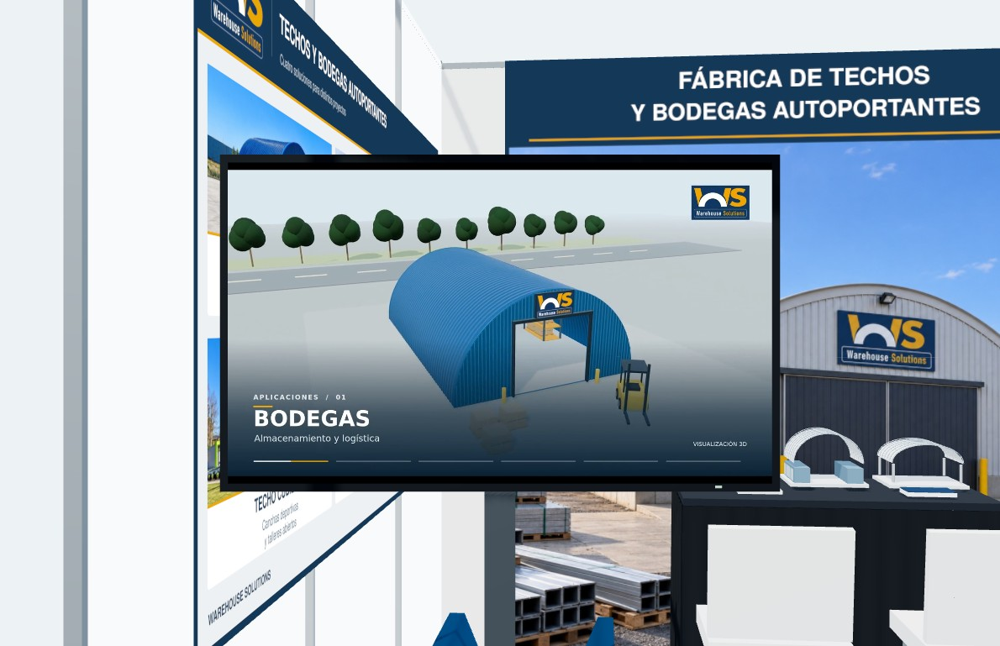

# Propuestas adicionales de la reunión

Página independiente: `/stand3d/reunion/`. No reemplaza ni modifica las versiones de la raíz.

- **V3 · Laterales bajos:** una bandeja en cada costado, pantalla al frente izquierdo, mesa con mantel negro al fondo y dos sillas.
- **V4 · Muestras al fondo:** expositor bajo posterior de dos niveles, mesa izquierda y pantalla derecha.
- **V5 · Atril inclinado:** dos bandejas inclinadas atrás a la izquierda, mesa derecha y pantalla al frente izquierdo.

## Criterios incorporados

Stand de 3 × 3 × 2,5 m. Televisor de 93 × 56 cm: esas medidas no corresponden a las muestras de acero. Dos bandejas azul/gris, una lisa y otra corrugada, distintas de las pequeñas maquetas plásticas sobre la mesa. Mesón WS retirado sólo en estas propuestas.

Fondo con la imagen de la propuesta Corporativa, retocada con iluminación natural y conservando el logo WS. Mensaje principal: “Fábrica de techos y bodegas autoportantes”. Cuatro paños de PVC: uno horizontal en cada costado y dos horizontales unidos en el fondo. Borde impreso, sin añadir el bastidor decorativo de versiones anteriores. Cenefa 240 × 24 cm con marca, actividad y número 2-D02.

Panel izquierdo en cuadrícula. Se conserva el orden de las cuatro aplicaciones; el uso de Techo Serviteca cambia a “Centros de logística y distribución”. Los dos dibujos técnicos comparten el título “Geometría de la cubierta”. Se elimina el subtítulo “Aplicaciones y espacios de uso”. Nueve ventajas con textos abreviados; el plazo de montaje se corrige a “Menor a 3 semanas”, sujeto a revisión comercial antes de imprimir.

Panel derecho: las ventajas ocupan la zona izquierda y “Nuevos desarrollos”, con las imágenes de cabaña y lodge, ocupa el extremo derecho de la plancha, hacia el acceso y el pasillo del stand.

## Supuestos visibles en el visor

- Se puede comparar plancha 122 × 240 cm y 122 × 244 cm: ambas medidas se mencionaron. Por defecto se mantiene el largo de 240 cm indicado por escrito. Fondo compuesto: 240/244 cm de ancho × 244 cm de alto, con junta horizontal a la mitad. Comprobar altura útil y fijación con el recinto.
- Las muestras tienen 150 cm de largo de trabajo; también se discutió acortarlas. Ancho de 60 cm, perfil, ligera curvatura, corrugado, inclinación y soportes son ilustrativos.
- Mesa de referencia: 105 × 52 cm. Confirmar la mesa disponible, sillas y soporte móvil de TV. La pantalla permite comparar orientación horizontal y vertical.
- El hangar usa la imagen entregada por el cliente el 14 de octubre; la cubierta incorpora el retoque previo. Cabaña y lodge son propuestas conceptuales generadas, no fotografías de obras ejecutadas. Revisar las imágenes y la resolución final antes de imprimir.
- Resolver el montaje permitido sin pegar ni perforar el recinto. El visor no calcula estructuras ni fijaciones.

## Archivos

`config.js` contiene propuestas, medidas y textos. `main.js` contiene el modelo y controles. `assets/` contiene nuevas gráficas SVG/JPG y capturas del modelo. Los SVG combinan textos y dibujos vectoriales con fotografías incrustadas: no son artes finales de imprenta. No se incluyen audios ni transcripciones de la reunión.

### Imágenes actualizadas · 11 de octubre de 2026

Las cinco imágenes se generaron con la herramienta integrada ImageGen. Las referencias originales fuera de `reunion/` se conservan sin cambios.

- [Hangar retocado](assets/imagenes/hangar-retocado.jpg): explanada de hormigón despejada y sin equipos ni elementos que distraigan.
- [Cubierta retocada](assets/imagenes/cubierta-retocada.jpg): techo completo, sin el árbol ni personas que lo ocultaban.
- [Fondo corporativo natural](assets/imagenes/fondo-corporativo-natural.jpg): luz diurna neutra, pavimento seco y marca WS conservada.
- [Cabaña conceptual](assets/imagenes/desarrollo-cabana.jpg): un volumen de cubierta curva, madera y vidrio.
- [Lodge conceptual](assets/imagenes/desarrollo-lodge.jpg): tres volúmenes curvos conectados en un entorno de montaña.

[Prompts y referencias de generación](assets/imagenes/prompts.json). Las gráficas y las doce vistas de V3, V4 y V5 incorporan esta revisión.

El visor usa Three.js y OrbitControls ya presentes en `../assets/vendor/`; no necesita compilación ni dependencias de red. Se publica junto con el sitio mediante el flujo existente de GitHub Pages. Para editar las gráficas, ejecutar `node reunion/tools/build-artwork.mjs` desde la raíz con `sharp` instalado. Este generador sólo escribe en `reunion/assets/`.

## Video en la TV del modelo

La pantalla de V3, V4 y V5 reproduce el video de aplicaciones 3D de Warehouse Solutions automáticamente, en bucle y sin audio. Dura 60 segundos y muestra bodega, techo sobre contenedores, taller, cancha cubierta, cabaña y lodge; son representaciones conceptuales. El botón «Pausar video TV» permite detenerlo y reanudarlo. Si el navegador bloquea el inicio automático, aparece «Reproducir video TV».

El archivo `assets/video/ws-aplicaciones-3d.mp4` es una copia optimizada para el visor: H.264, 1280 × 720, 30 fps, sin audio y con inicio progresivo. El máster Full HD se conserva por separado. Una sola textura de video mantiene la reproducción al cambiar de propuesta, orientación o formato de plancha; el encuadre 16:9 se conserva mediante bandas negras. La imagen `assets/video/poster.jpg` se muestra durante la carga o si el video no está disponible.

El movimiento dentro de la TV requiere WebGL. Si no está disponible, el visor conserva las doce imágenes de referencia del stand, con un fotograma del video.

### Cambio de imagen · 14 de octubre de 2026

La foto de «TECHO HANGAR», en la esquina superior izquierda de la plancha izquierda, se reemplaza por la imagen adjunta del hangar azul con el letrero «piso caminante». Se extrajo el JPEG original del PDF entregado por el cliente, sin regenerarlo ni retocarlo. Se conserva el archivo completo en `assets/imagenes/hangar-cliente-20261014.jpg`; el arte usa un encuadre alto para mantener visible la cima del arco en la casilla apaisada. V3, V4 y V5 comparten esta plancha. El JPG, SVG y las vistas del modelo reflejan el cambio.

### Nuevos desarrollos · referencias del cliente · 14 de octubre de 2026

Las dos imágenes del extremo derecho de la plancha derecha se regeneran con ImageGen a partir de las referencias enviadas: foto 2 arriba y foto 3 abajo. Se amplía el entorno al formato panorámico, se eliminan las bandas negras de la foto 2 y se mantienen las fachadas acristaladas, los techos curvos y el carácter de ambas casas. Los edificios completos quedan dentro de sus recuadros; la posición hacia el pasillo se conserva. V3, V4 y V5, el JPG, el SVG y las vistas de referencia incorporan la revisión.

- [Foto 2 · recuadro superior](assets/imagenes/desarrollo-cabana-cliente-20261014.jpg): 1686 × 804 px, misma proporción que el espacio de 562 × 268 del arte.
- [Foto 3 · recuadro inferior](assets/imagenes/desarrollo-lodge-cliente-20261014.jpg): 1686 × 807 px, misma proporción que el espacio de 562 × 269 del arte.
- [Prompts, referencias y formato](assets/imagenes/prompts-desarrollos-20261014.json): herramienta integrada ImageGen. Son imágenes conceptuales regeneradas, no documentos de una obra construida.

### Imágenes escaladas 4× · 14 de octubre de 2026

Se incorporan los diez TIFF escalados entregados por el cliente: hangar, contenedor, cubierta, serviteca, ambos dibujos AutoCAD, galpón de campo, las dos imágenes de nuevos desarrollos y el fondo corporativo. La distribución, los encuadres, los textos y el logo conservan el diseño aprobado. Las versiones anteriores de la raíz permanecen disponibles.

`assets/imagenes-hd/` contiene copias JPEG a las dimensiones completas de los TIFF, con calidad 95–96, muestreo 4:4:4 y color sRGB. `manifest.json` registra dimensiones, nombres de origen y huellas SHA-256 de los TIFF; estos se conservan por separado y no se incluyen en el sitio. Para repetir la importación: `node reunion/tools/import-upscaled.mjs /ruta/a/los/tiff`.

El botón de descarga genera un SVG autónomo con estas imágenes completas incrustadas, sin reducirlas ni volver a comprimirlas. Las plantillas SVG del repositorio enlazan las imágenes para evitar duplicar sus datos en el código fuente. Los JPG del visor se renderizan directamente desde esos SVG con un lado máximo de 4096 píxeles; la cenefa mantiene su tamaño previo. El enlace «SVG con imágenes HD» descarga la versión con texto vectorial e imágenes completas. El escalado no cambia las medidas físicas del stand ni sustituye la preparación final de impresión.

### ZIP de paneles para impresión

El botón «ZIP para imprimir» está junto a «Revisar gráficas» y dentro de la ventana de gráficas. Descarga `descargas/WS_Paneles_completos_para_imprimir.zip`, con seis JPG a 150 ppp y seis SVG autónomos con imágenes HD, medidas e indicaciones de impresión. Incluye ambos laterales de 240 × 122 cm, el fondo de 240 × 244 cm completo y dividido en dos mitades, y la cenefa de 240 × 24 cm. El paquete corresponde al formato de plancha 122 × 240 cm indicado en el botón, incluso si el visor se cambia a 244 cm.

La publicación genera el ZIP desde los SVG y las fotografías HD existentes mediante `tools/build-print-package.mjs`. Requiere Node.js 24, Python 3, `fonts-urw-base35` y `npm install --prefix reunion/tools`; ejecutar `npm run build:print --prefix reunion/tools` desde la raíz. La versión de Sharp está fijada en `tools/package.json`. Cada JPG se comprueba por tamaño y densidad y se verifica la integridad del ZIP. El paquete se incorpora al sitio desplegado y se excluye de Git. El navegador inicia una descarga directa, sin renderizar los paneles ni mantener todo el ZIP en memoria.
